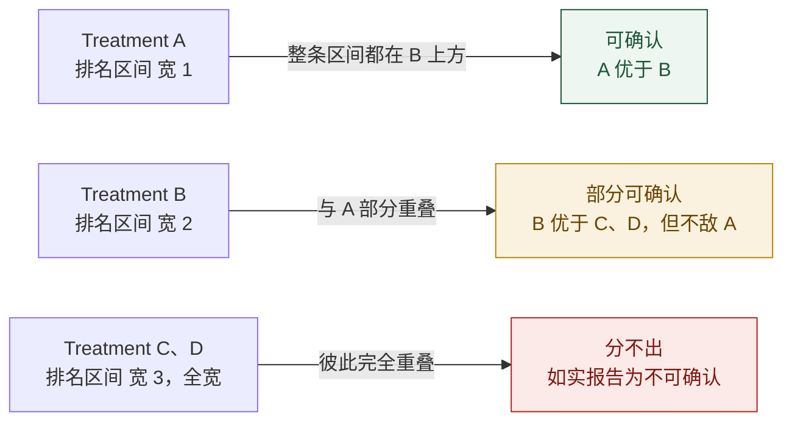
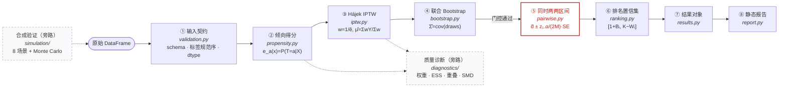
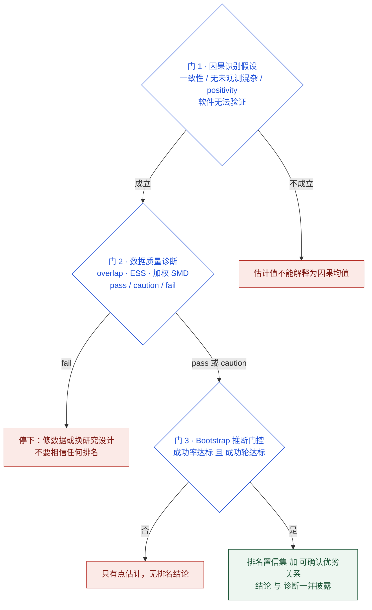
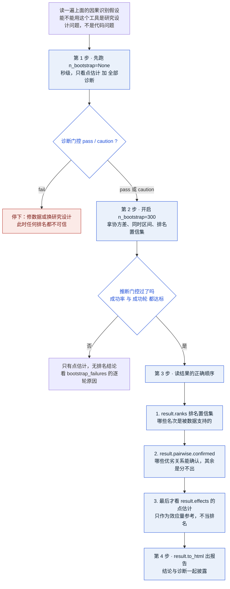

# CausalRank

[](https://pypi.org/project/causalrank/)
[](https://pypi.org/project/causalrank/)
[](LICENSE)

> 观测数据里有 **K 个互斥的 Treatment**，混杂因素让它们的表面均值不可比。
> **CausalRank** 从原始 DataFrame 出发，在**同一目标总体**上估计每个 Treatment 的平均潜在结果，
> 用**联合 Bootstrap** 量化它们之间完整的不确定性，最后回答一个诚实的问题：
> **哪些优劣关系是统计上能确认的，哪些分不出。**

它交付的不是一句"A 最好"，而是一份**可以追溯到公式、假设和诊断的质量门控排名**。

---

## 这个工具解决什么问题

把各 Treatment 分别做一次调整、各自算一个均值、按大小排序——这是最常见的做法，也是最容易出错的做法。
它有两个致命问题：

1. **各组目标总体不同**：每组单独对照另一个对照组，比较的不是同一个 `E[Y(a)]`，排名失去可比性；
2. **把点估计排序当成排名**：两个均值 0.24 和 0.25 的 Treatment，样本一大就能排出 1 和 2，
   但它们的差异可能完全在噪声里。**排序算法永远会给你一个 1-2-3-4，问题是它凭什么。**

CausalRank 针对这两点：所有 Treatment 在**同一个目标总体**上估计，并用**多重比较校正后的排名置信集**
告诉你排名的哪一部分是被数据支持的。

### 点排名 vs 排名置信集（示意）

| Treatment | 调整后均值 | 点排名 | 排名置信集 | 能确认的优劣关系 |
|---|---|---|---|---|
| **A** | 0.25 | 1 | **[1, 2]** | A 优于 B、C、D |
| **B** | 0.24 | 2 | **[1, 3]** | B 优于 C、D |
| **C** | 0.18 | 3 | **[2, 4]** | — |
| **D** | 0.17 | 4 | **[2, 4]** | — |

点排名给出干净的 1-2-3-4。但排名置信集揭示：**C 和 D 的区间是全宽 [2,4]——它们分不出高下。**
这不是算法失败，而是诚实答案。把 C 报成"第 3 名"、D 报成"第 4 名"，是在报告噪声。

区间宽度直接告诉你结论的可信程度：



---

## 端到端流水线

从原始数据到可分发的报告，主链 8 站；两条旁路只读取主链产物，一个门控决定推断是否放行。



- **实线** = 主链数据流；**虚线** = 旁路（只读，不改数据）；
- **④→⑤ 之间的红色门控**：Bootstrap 成功率不达标时**直接不返回 Σ**——宁可没有结论，也不给可疑的协方差；
- **诊断旁路**随时读取 ②③ 的产物给出质量门控；**合成验证**用已知真值反复校准整条链路的统计正确性。

---

## 三道质量门

排名结论要可信，必须三道门都过。前两道软件会替你查，第一道只能你自己负责。



---

## 安装

要求 Python ≥ 3.11。从 [PyPI](https://pypi.org/project/causalrank/) 安装：

```bash
pip install causalrank
# 或 uv pip install causalrank
```

开发环境使用 [uv](https://docs.astral.sh/uv/)：

```bash
uv sync                 # 创建 .venv 并安装 runtime + dev 依赖
uv run pytest           # 运行测试
uv run ruff check .     # lint
uv run mypy             # 类型检查
uv build                # 打包检查
```

或在本地以可编辑模式安装：

```bash
uv pip install -e .      # 或 pip install -e .
```

## 快速开始

```python
import pandas as pd
from causalrank import CausalRank

# df 需包含：treatment 列（互斥 K 类）、outcome 列（0/1）、Treatment 前协变量列
df = pd.read_csv("your_data.csv")

model = CausalRank(
    treatment="route",
    outcome="converted",
    confounders=["age", "income", "gender", "previous_visits"],
    estimator="iptw",            # 目前唯一估计器：Hájek IPTW
    propensity_model="gbm",      # 倾向得分预测模型（多分类 GBM）
    estimand="population_mean",  # mu_a = E[Y(a)]，同一目标总体
    weighting="hajek",           # 组内归一化 IPTW（不改变估计目标）
    cross_fit=5,                 # 可选：out-of-fold 倾向得分
    confidence_level=0.95,
    n_bootstrap=300,             # >= 1 显式开启联合 Bootstrap 推断（SE/CI/排名）
    random_state=2026,
)
result = model.fit(df)

print(result.summary())               # 估计值、SE/CI、排名置信集、诊断与质量门控
print(result.effects.to_dataframe())  # mu_a、se、ci、原始均值、权重、ESS
print(result.covariance)              # K×K 联合 Bootstrap 协方差
print(result.ranks.to_dataframe())    # 点排名 + 排名置信区间 [1+B_i, K-W_i]
print(result.pairwise.to_dataframe()) # 两两同时区间与可确认优劣关系
print(result.pairwise.confirmed)      # 只看能确认的优劣关系
print(result.diagnostics.summary())   # overlap / 权重 / SMD 诊断
for w in result.diagnostics.warnings:
    print(w.level, w.code, w.message)

result.to_html("report.html")         # 自包含静态 HTML 报告，可直接分发
result.plot("estimates")              # 5 种图见下
```

> **`n_bootstrap` 是显式开关**：默认 `None` 只输出点估计与诊断（**秒级**）；
> 设为 `300` 会每轮重新拟合全部协议来估计协方差（**分钟级**，可 `n_jobs` 并行，
> 且结果与串行逐位一致）。**先在 `None` 下把诊断看清，再开启推断。**

### 结果对象里有什么

| 成员 | 内容 | 需要 Bootstrap |
|---|---|---|
| `result.effects` | 每个 Treatment 的 `mu` / `se` / `ci` / 原始均值 / 权重 / ESS | SE/CI 需要 |
| `result.covariance` | `K×K` 联合协方差，列顺序与标签严格一致 | 需要 |
| `result.pairwise` | `K(K-1)/2` 个差值、SE、Bonferroni 同时区间、可确认方向；`.confirmed` 只留可确认的 | 需要 |
| `result.ranks` | 点排名 + 排名置信集 `[1+Bᵢ, K−Wᵢ]` | 需要 |
| `result.diagnostics` | 倾向得分、权重、ESS、SMD、Bootstrap 稳定性、17 类警告码 | 部分 |
| `result.metadata` | estimator / estimand / 样本数 / 模型参数 / 版本 / 随机种子 | 否 |
| `result.to_html(path)` | 自包含静态 HTML 报告（含全部 SVG 图与诊断） | 否 |
| `result.plot(kind)` | `estimates` · `ranks` · `balance` · `ess` · `overlap` | `ranks` 需要 |

低层排名内核可单独验证（不依赖任何模型）：

```python
from causalrank.inference import rank_from_estimates

ranking = rank_from_estimates(
    estimates={"A": 0.25, "B": 0.24, "C": 0.17},
    covariance=sigma,
    confidence_level=0.95,
    method="bonferroni",
)
```

## 估计方法（一句话版）

- **倾向得分**：`e_a(x) = P(T=a|X=x)`，由**联合多分类** GBM（scikit-learn
  `HistGradientBoostingClassifier`）估计；预处理（缺失插补、one-hot）全部包在 Pipeline 内、
  只在训练折内 fit，避免信息泄露。
- **估计器**：Hájek IPTW，`w_i = 1 / e_{T_i}(X_i)`，
  `μ̂ₐ = Σ_{Tᵢ=a} wᵢ Yᵢ / Σ_{Tᵢ=a} wᵢ`，所有 Treatment 在**同一目标总体**上比较。
- **不确定性**：对同一索引重抽样、每轮**重跑全部拟合协议**，得到 `B×K` 估计，
  由 `np.cov(draws, ddof=1)` 得联合协方差 `Σ`（**不再除以 n**）。
- **推断**：Bonferroni 同时两两区间 → 可确认优劣关系 → 保守排名置信集 `[1+Bᵢ, K−Wᵢ]`。

完整定义、公式、适用条件与数值边界见 [`docs/methodology.md`](docs/methodology.md) 与
[`docs/assumptions.md`](docs/assumptions.md)。

## 诊断与 17 个警告码

诊断分五组；每个警告码有稳定名称，可追溯到触发条件。级别分布 `info ×2` / `warning ×12` / `critical ×3`。

| 组 | 警告码 | 级别 | 触发条件 |
|---|---|---|---|
| **validation** ×6 | `label_dtype_cast` | info | 标签被安全转换类型（int/str/bool/float 整数值） |
| | `missing_covariates` | info | 协变量存在缺失，将在训练折内插补 |
| | `high_cardinality_categorical` | warning | 类别基数超过 `max_category_cardinality`（默认 25） |
| | `small_group` | warning | 某臂样本数低于 `min_group_n`（默认 30） |
| | `rare_treatment` | warning | 稀有臂，交叉拟合折与 Bootstrap 重抽样风险高 |
| | `duplicate_rows` | warning | 完全重复行——iid 抽样假设存疑，聚类结构需 cluster bootstrap |
| **weights** ×3 | `low_ess` | warning | ESS < `min_ess`（30）或 ESS 比 < 0.2 |
| | `extreme_weight` | warning | 单条权重占该臂总权重 > 10% |
| | `propensity_clipped` | warning | 显式裁剪实际发生——必须与结果一起披露 |
| **overlap** ×3 | `no_common_support` | **critical** | 部分目标样本上 `e_a(X)=0`：该臂均值在那里不可识别 |
| | `weak_common_support` | warning | 目标样本低概率占比 > 5%——`population_mean` 依赖外推 |
| | `low_propensity` | warning | 实际处理倾向 < 0.01，或近确定性分配占比过高 |
| **balance** ×3 | `degenerate_smd` | warning | 组内方差为零 → SMD = ±∞（图中钉在边界并标注 ∞） |
| | `residual_imbalance` | warning | 加权后 `max|SMD| > 0.1`——筛查惯例，不是无偏保证 |
| | `severe_imbalance` | **critical** | 加权后 `max|SMD| > 0.25`——调整均值可能仍被混杂 |
| **bootstrap** ×2 | `bootstrap_failures` | warning | 存在失败轮（低于门槛时升为 critical），逐轮记录原因 |
| | `bootstrap_inference_blocked` | **critical** | 成功率 < 90% 或成功轮 < 30：推断阻断，不返回 `Σ` |

模型 AUC / 准确率 **不能**作为因果估计可靠的证据。诊断不通过时，软件降级质量门控并输出警告，
**不会**输出"可靠因果排序"类结论。

## 合成数据与验证

`causalrank.simulation` 提供**已知真实潜在结果均值** `mu_true` 的可配置 DGP
（独立大规模 Monte Carlo 参考 + MC 标准误），内置 8 个场景：

| 场景 | 验证目标 |
|---|---|
| 随机化 / 近随机化 | 基本公式，与分组原始均值接近 |
| 正确建模的混杂 | IPTW 在有混杂下恢复 `mu_true` |
| 强混杂 | 权重与 SMD 诊断能否抓住失衡 |
| 弱重叠 | ESS、极端权重、估计不稳定与警告 |
| 稀有 Treatment | 折划分与 Bootstrap 有效性 |
| 效应相等 | 不能凭样本噪声宣称确定排名 |
| 效应接近 / 分离 | 排名置信集宽度与统计功效 |
| 混合类型 + 缺失 | 编码、缺失值与模型管线 |

覆盖率、`se_ratio`、偏差等 Monte Carlo 指标与协议见
[`docs/simulation_protocol.md`](docs/simulation_protocol.md)。端到端示例：

- [`01_gbm_iptw_from_raw_data.ipynb`](examples/01_gbm_iptw_from_raw_data.ipynb) — 原始数据 → 调整后均值 + 诊断
- [`02_joint_bootstrap.ipynb`](examples/02_joint_bootstrap.ipynb) — 联合 Bootstrap 协方差与 SE 校准
- [`03_causal_ranking.ipynb`](examples/03_causal_ranking.ipynb) — 同时区间与排名置信集
- [`04_html_report.ipynb`](examples/04_html_report.ipynb) — CSV → 自包含 HTML 报告

## ⚠️ 因果识别假设（软件无法验证）

只有在以下条件成立时，IPTW 估计值才能解释为因果平均潜在结果 `μₐ = E[Y(a)]`：

1. **一致性（consistency）**：观测结果等于所接受 Treatment 的潜在结果，Treatment 版本定义一致；
2. **条件可交换性（无未观测混杂）**：给定协变量 `X` 后，Treatment 分配与潜在结果独立。
   **软件无法检查这一点**；遗漏混杂会直接使估计有偏；
3. **Positivity（共同支持）**：每个 `x` 上每种 Treatment 的倾向得分都为正。弱重叠导致极端权重与
   不稳定估计，诊断会警告但**不能修复**；
4. **SUTVA / 无干扰**：个体之间潜在结果互不影响；
5. **iid 抽样**：观测行独立同分布（存在客户/家庭/机构聚类时本版本不适用，需 cluster bootstrap）；
6. **协变量必须测量于 Treatment 之前**。把 Treatment 后变量（中介、后果）当作混杂调整会引入偏差。

**仅用于研究与方法验证**，不构成任何业务、医疗或政策决策建议。

---

## 建议使用方式

按下面的顺序用，能避开绝大多数误用。核心原则：**先看诊断，再看推断；先看能不能确认，再看点估计。**



**四条最容易犯的错，以及正确做法：**

| ❌ 常见误用 | ✅ 正确做法 |
|---|---|
| 一上来就 `n_bootstrap=300`，盯着点估计排序下结论 | 先 `n_bootstrap=None` 看诊断门控；fail 就别往下走 |
| 把点排名 1-2-3-4 直接当结论，忽略置信集 | 先看 `result.ranks` 的置信集；全宽区间 = 分不出，如实报告 |
| 把 `inconclusive`（分不出）读成"两者相等" | 分不出 ≠ 相等。不显著不能作为效果相等的证据 |
| 报告里只给排名，不给 ESS / SMD / 重叠诊断 | 结论与诊断一起披露；诊断是结论可信度的一部分 |

**什么时候不该用这个工具**：数据存在聚类/重复行（需 cluster bootstrap，本版本不适用）、
协变量测量于 Treatment 之后、或者你无法为"无未观测混杂"给出任何辩护——
这些情况下软件的诊断会提示，但**结论仍由你负责**。

---

## 项目结构

```text
src/causalrank/        包源码
  api.py · config.py · validation.py · results.py
  estimators/          倾向得分（GBM）+ Hájek IPTW
  diagnostics/         overlap · weights · balance
  inference/           联合 Bootstrap · 同时区间 · 排名置信集
  simulation/          已知真值 DGP + Monte Carlo 基准
  visualization/       静态 HTML 报告与内联 SVG 图
tests/                 185 项 pytest 测试（13 个测试文件）
examples/              4 个可执行示例 Notebook
docs/                  方法、假设、模拟协议、API、架构可视化
```

技术架构的可视化讲解见 [`docs/architecture.html`](docs/architecture.html)（数据流、模块分层、
17 个警告码、校准结果）。API 参考见 [`docs/api.md`](docs/api.md)。

## 许可证

MIT（暂定，见 `LICENSE`）。参考文献的使用约定见 [`docs/references.md`](docs/references.md)。
